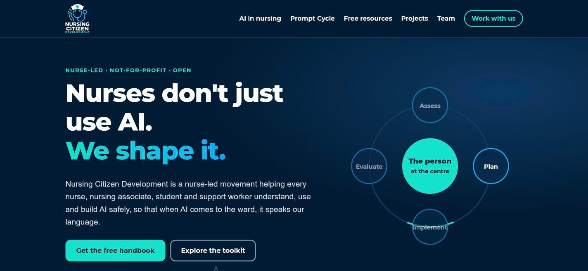

# Nursing Citizen Development

**Nurses don't just use AI. We shape it.**

The website of [Nursing Citizen Development CIC](https://nursingcitizendevelopment.com), a nurse-led, not-for-profit community interest company helping every nurse, nursing associate, student and support worker understand, use and build AI safely.

**Live site:** https://nursingcitizendevelopment.com

## What's on the site

- **The NCD Nursing Prompt Cycle:** using AI through Assess, Plan, Implement and Evaluate, with an interactive example
- **Where nurses meet AI:** assistants, AI scribes, equity, images, agents and a "Can I use this tool?" check
- **Free resources:** [The Nursing Copilot Handbook](https://handbook.nursingcitizendevelopment.com) and the [NCD AI Nursing Toolkit](https://practicedev.cloud)
- **NHS AI capability framework mapping:** how our resources cover the NHS AI and Digital Healthcare Technologies Capability Framework
- **Open projects, the team, and ways to work with us**

## How it's built

Plain HTML, CSS and a little JavaScript. No build step and no frameworks. Hosted on GitHub Pages from the `main` branch.

| Path | What it is |
|---|---|
| `index.html` | Home page |
| `capability-framework.html` | NHS AI capability framework mapping |
| `privacy.html`, `terms.html`, `accessibility.html` | Privacy and cookies, terms of use, accessibility statement |
| `assets/site.css`, `assets/site.js` | Styles and the menu and Prompt Cycle tabs |
| `assets/consent.js` | Cookie consent; Google Analytics loads only after a visitor accepts |
| `assets/fonts/` | Self-hosted Montserrat (SIL Open Font Licence) |
| `about.html`, `partner.html` and similar | Redirects from the old site's addresses |

Built to WCAG 2.2 AA: keyboard accessible, screen reader friendly, and respects "reduce motion".

## Contributions

This repository is maintained by Nursing Citizen Development CIC. Changes to `main` need the owner's approval. To suggest a correction or idea, please use our [feedback form](https://forms.cloud.microsoft/e/yzyL2maEfT) or email info@nursingcitizendevelopment.com instead of opening a pull request.

## Licence

Content is © 2026 Nursing Citizen Development CIC and licensed under [CC BY-NC-SA 4.0](https://creativecommons.org/licenses/by-nc-sa/4.0/) unless marked otherwise. The Nursing Citizen Development name, the NCD logo and team photographs are **not** covered by the licence.

Nursing Citizen Development CIC is registered in England and Wales, company no. 17324367. Educational resource only: not clinical guidance.
